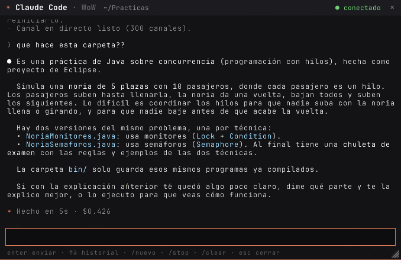
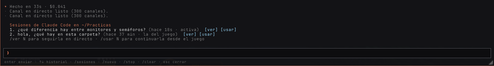
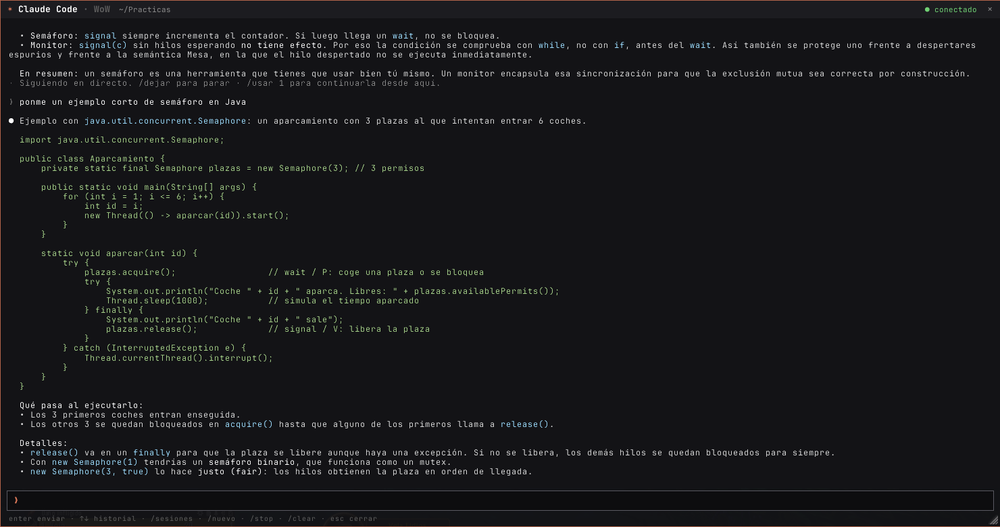
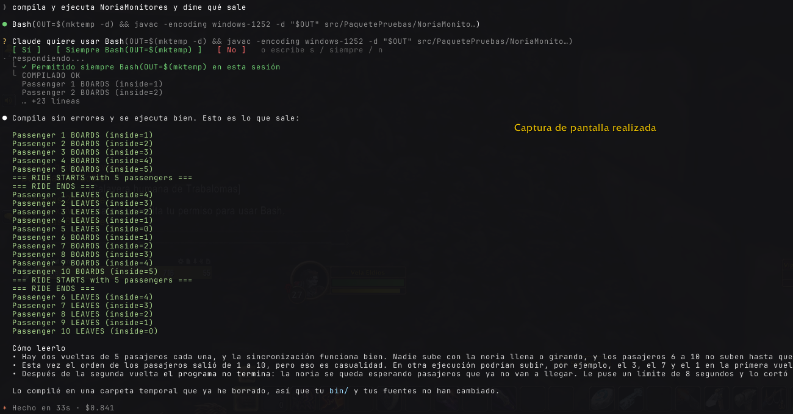

# Claude x WoW

**Your Claude Code, inside World of Warcraft.** A Claude Code–style terminal in the game: send tasks for your project, watch live which files it reads, edits and which commands it runs, and keep playing while it works.

[Download on CurseForge](https://www.curseforge.com/wow/addons/claude-terminal) · [Versión en español](README.md) · [Releases](https://github.com/VelaElDios/claude-x-wow/releases)



> **Unofficial** project. Not affiliated with or endorsed by Anthropic or Blizzard Entertainment. "Claude" is a trademark of Anthropic and "World of Warcraft" of Blizzard. The in-game UI is in Spanish.

## Features

- **In-game terminal** (`/claude`, minimap button or key binding): live responses, colored Markdown, aligned tables, ↑↓ history.
- **Permissions from the game**: when Claude wants to run something it asks you with **Yes / This session / Always / No** buttons.
- **Connected to your terminal**: `/sesiones` lists your Claude Code conversations; `/ver N` follows live what you do in Warp or any terminal; `/usar N` continues that conversation from the game.
- **Full control**: switch project (`/proyecto`), model (`/modelo`) or mode (`/modo plan`) without leaving the game.
- **Notifications**: with the terminal closed, a sound tells you when Claude finishes or needs something.

| What you do in your terminal… | …shows up in the game |
|---|---|
|  |  |



## Install

**Requirements:** Windows, [Claude Code](https://docs.claude.com/en/docs/claude-code) installed and logged in, Node.js 18+, WoW Forever.

```bash
npm install -g github:VelaElDios/claude-x-wow
claude-x-wow setup --project "C:\path\to\your\project"
```

## Usage

1. Start the bridge **before** WoW and keep it open while you play: `claude-x-wow start`
2. Open WoW (first time: keep "Claude x WoW" and all "canal ###" addons enabled).
3. In game: `/claude`.

| Command | What it does |
|---|---|
| `<task>` + Enter | Sends a task to Claude Code |
| `/sesiones` · `/ver N` · `/usar N` · `/dejar` | Terminal sessions: list, follow live, continue, stop following |
| `/proyecto` · `/modelo` · `/modo` | Project, model (sonnet/opus/haiku) and mode (editar/preguntar/plan) |
| `/permisos` · `/olvidar N` | Saved "Always" permissions |
| `/nuevo` · `/stop` · `/clear` · `/recargar` | New conversation, stop, clear, reload |

## How it works

WoW addons have no network and can't run programs, so there are two parts: the **`ClaudeXWoW` addon** (Lua, the in-game terminal) and the **`claude-x-wow` bridge** (Node, runs Claude Code on your PC). They talk through a live two-way channel without `/reload`:

- **Game → PC:** the addon briefly draws a strip of colored blocks in the top-left corner; the bridge screen-captures and decodes it (sync row, color calibration, checksum).
- **PC → game:** the bridge writes each batch of events into a LoadOnDemand *slot addon* and signals it with a 10-bit Gray-code counter made of empty files it deletes/recreates — `PlaySoundFile` reports whether a file exists, checked live for files present at game start.
- **Fallback:** everything also works through `/reload` (SavedVariables + `Inbox.lua`).

Claude Code runs as `claude -p --output-format stream-json --resume`; permissions go through `--permission-prompt-tool` and a tiny MCP server (`bridge/permission-mcp.js`).

## Security

Claude Code runs **on your PC**, only in the chosen project folder. The addon only uses documented APIs: no memory reading, no automated input. By default it can read/edit project files and **asks in-game for everything else**; for compound shell commands, "Always" only applies to that exact command.

## Development

```bash
npm install && npm test
```

The tests run the real addon Lua (via fengari) against the bridge to make sure both speak the same protocol.

## License

MIT · Made by Javier Vela
