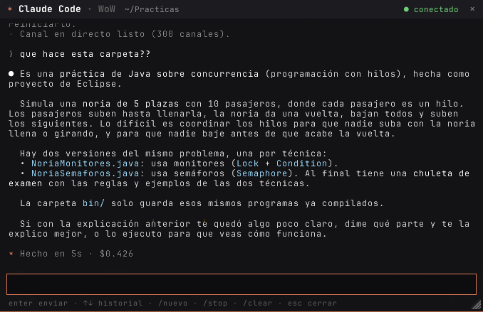
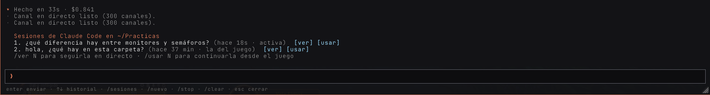
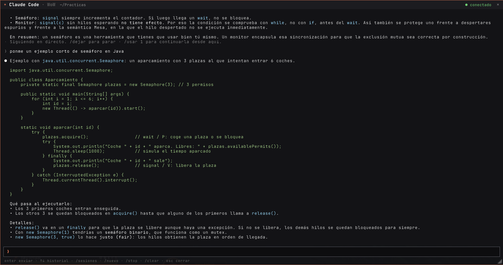

# Claude x WoW

**Tu Claude Code, dentro de World of Warcraft.** Una terminal con el estilo de Claude Code en el juego: le mandas tareas para tu proyecto, ves en directo qué archivos lee, qué edita y qué comandos ejecuta, y sigues jugando mientras trabaja.

[English version](README.en.md) · [Releases](https://github.com/VelaElDios/claude-x-wow/releases)



> Proyecto **no oficial**. No está afiliado ni respaldado por Anthropic ni por Blizzard Entertainment. "Claude" es marca de Anthropic y "World of Warcraft" de Blizzard.

## Qué hace

- **Terminal en el juego** (`/claude`, botón en el minimapa o atajo de teclado): respuestas en directo, Markdown con colores, tablas alineadas, historial con ↑↓.
- **Permisos desde el juego**: cuando Claude quiere ejecutar algo, te pregunta con botones **Sí / Esta sesión / Siempre / No**.
- **Conectado con tu terminal**: `/sesiones` lista tus conversaciones de Claude Code; `/ver N` sigue en directo lo que haces en Warp o en cualquier terminal; `/usar N` continúa esa conversación desde el juego.
- **Control total**: cambia de proyecto (`/proyecto`), de modelo (`/modelo`) o de modo (`/modo plan`) sin salir del juego.
- **Avisos**: si tienes la terminal cerrada, te avisa con un sonido cuando Claude termina o necesita algo.

| Lo que haces en Warp… | …aparece en el juego |
|---|---|
|  |  |

## Instalación

**Requisitos:** Windows, [Claude Code](https://docs.claude.com/en/docs/claude-code) instalado y con sesión iniciada (`claude` en la terminal), Node.js 18+ y WoW Forever.

```bash
npm install -g github:VelaElDios/claude-x-wow
claude-x-wow setup --project "C:\ruta\a\tu\proyecto"
```

`setup` detecta el WoW, instala el addon y crea los canales en directo. Si no encuentra el juego: `--wow "C:\Program Files (x86)\World of Warcraft\_forever_"`.

## Uso

1. Abre el puente **antes** que el WoW y déjalo abierto mientras juegas:
   ```bash
   claude-x-wow start
   ```
2. Abre el WoW (la primera vez, en la lista de addons deja activados "Claude x WoW" y todos los "canal ###").
3. En el juego: `/claude`.

### Comandos de la terminal

| Comando | Qué hace |
|---|---|
| `<tarea>` + Enter | Manda una tarea a Claude Code |
| `/sesiones` · `/ver N` · `/usar N` · `/dejar` | Tus sesiones de la terminal: listar, seguir en directo, continuar, dejar de seguir |
| `/proyecto [N\|nombre]` | Lista o cambia la carpeta de trabajo (cada una recuerda su conversación) |
| `/modelo [sonnet\|opus\|haiku\|defecto]` | Modelo de Claude |
| `/modo [editar\|preguntar\|plan]` | Editar sin preguntar, preguntar también las ediciones, o solo planificar |
| `/permisos` · `/olvidar N` | Permisos guardados con "Siempre" |
| `/nuevo` · `/stop` · `/clear` · `/recargar` | Conversación nueva, parar, limpiar, recargar |
| `s` · `sesion` · `siempre` · `n` | Responder a una petición de permiso |

Desde el chat funciona igual con `/claude <comando>` (por ejemplo `/claude sesiones`). El atajo de teclado se configura en *Atajos de teclado > AddOns > Claude x WoW*.

## Cómo funciona

Los addons de WoW no tienen red ni pueden ejecutar programas, así que hay dos piezas:

| Pieza | Qué hace |
|---|---|
| **Addon `ClaudeXWoW`** (Lua) | La terminal del juego |
| **Puente `claude-x-wow`** (Node) | Corre en tu PC, lanza Claude Code en tu proyecto y comunica con el juego |

Y un canal en directo en los dos sentidos, sin `/reload`:

- **Juego → PC:** al enviar, el addon dibuja un instante una tira de cuadraditos de colores (256×48 px) en la esquina superior izquierda. El puente la captura de la pantalla y la decodifica (sincronía, calibración de color y checksum).
- **PC → juego:** el puente escribe cada lote de eventos en un *addon ranura* (`ClaudeXWoW_S001`…, LoadOnDemand, que el WoW lee del disco al cargarlo) y avisa con un contador de 10 bits hecho con archivos vacíos que borra o recrea (código Gray). `PlaySoundFile` dice si un archivo existe, y el cliente lo comprueba en caliente para archivos que existían al arrancar.
- **Respaldo:** si el directo no está disponible, todo funciona con `/reload` (SavedVariables + `Inbox.lua`).

Claude Code se ejecuta con `claude -p --output-format stream-json --resume`, y los permisos con `--permission-prompt-tool` a través de un pequeño servidor MCP propio (`bridge/permission-mcp.js`).

## Seguridad

- Claude Code se ejecuta en **tu PC**, solo en la carpeta de proyecto elegida. El addon solo usa APIs documentadas: no lee la memoria del juego ni pulsa teclas por ti.
- Por defecto puede leer y editar archivos del proyecto, y **todo lo demás te lo pregunta en el juego**. En comandos compuestos (`&&`, `;`, `|`…), "Siempre" solo vale para ese comando exacto.
- La configuración está en `~/.claude-x-wow/config.json` (`permissionMode`, `allowedTools`, `askPermissions`, `model`…).
- No lo apuntes a carpetas con credenciales o `.env`.

## Desarrollo

```bash
git clone https://github.com/VelaElDios/claude-x-wow
cd claude-x-wow && npm install && npm test
```

Los tests ejecutan el Lua real del addon (con [fengari](https://github.com/fengari-lua/fengari)) contra el puente, para comprobar que los dos hablan el mismo protocolo. Las versiones se publican solas al subir una etiqueta `vX.Y.Z` ([docs/CURSEFORGE.md](docs/CURSEFORGE.md)).

Ramas: `main` (estable, con etiquetas), `develop` (integración) y `feature/*` / `fix/*`.

## Licencia

MIT · Hecho por Javier Vela
